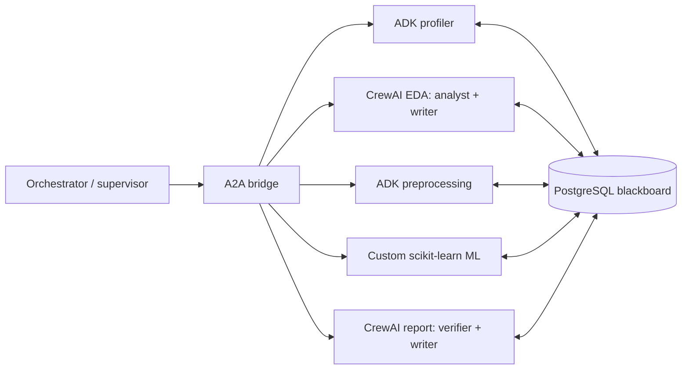

# ZeroCode

AutoML with FastAPI, PostgreSQL, React, Google ADK, CrewAI and Gemini. Existing analysis, training, chat, reports and downloads use a typed agent layer with persistent state, monitoring and tracing.

## Run locally (Windows, Python 3.11+)

From the repository root:

```powershell
uv venv --python 3.11 .venv
uv pip install --python .venv/Scripts/python.exe -r backend/requirements-dev.txt
if (-not (Test-Path backend/.env)) { Copy-Item backend/.env.example backend/.env }
docker compose up -d
cd frontend
npm install
cd ..
```

Set `GEMINI_API_KEY` in `backend/.env`. Start `start_backend.bat` and `start_frontend.bat` in separate terminals. The API runs at http://localhost:8000, its interactive documentation at http://localhost:8000/docs, the frontend at http://localhost:5173, and Jaeger at http://localhost:16686. SQLAlchemy creates the new `blackboard_state` and `agent_logs` tables alongside the existing tables; existing data is retained.

The model is set by `MODEL_NAME` in [config.py](backend/config.py).

## Academic criteria

| Criterion | Implementation | Review evidence |
| --- | --- | --- |
| 1. Shared state and messaging | PostgreSQL blackboard, worker-owned result sections; `MESSAGING_MODE=blackboard` or `direct` | [blackboard.py](backend/blackboard.py), [pipeline.py](backend/pipeline.py) |
| 2. MCP tools | Typed database, CSV and Gemini tools; real MCP stdio discovery/calls plus validated in-process dispatch | [tool_registry.py](backend/tool_registry.py), [MCP server](backend/mcp_tools/server.py) |
| 3. Pydantic contracts | Input/output models for all five workers and master state; contracts also wrap original public Python entry points | [schemas.py](backend/schemas.py), [legacy_contracts.py](backend/legacy_contracts.py) |
| 4. Execution patterns | Sequential, parallel `asyncio.gather`, and explicit supervisor/`WorkerNode` hierarchy | [pipeline.py](backend/pipeline.py), [worker.py](backend/agents/worker.py) |
| 5. Callbacks and heatmap | Start/complete/error callbacks, SQLAlchemy logs, stage-by-run duration PNG | [monitoring.py](backend/monitoring.py) |
| 6. A2A bridge | Typed envelopes, worker HTTP endpoints, discovery card and JSON-RPC `message/send` | [a2a_bridge.py](backend/a2a_bridge.py) |
| 7. ADK + CrewAI | Real ADK `Agent`/`Runner` and two-agent CrewAI `Crew.kickoff` executions | [ADK workers](backend/agents/adk), [CrewAI crews](backend/agents/crewai), [model adapters](backend/agents/framework_models.py) |
| 8. Guardrails | Upload/chat checks, full CSV text scan, tool-return schemas and guarded LLM output; three persona demo | [guardrails.py](backend/guardrails.py), [test_personas.py](backend/test_personas.py) |
| 9. Observability | Agent/tool spans, FastAPI instrumentation, session/run attributes and OTLP export to Jaeger | [observability.py](backend/observability.py), [Docker services](docker-compose.yml) |
| 10. Evaluation | Forty-run schedule, four prompt variants, three datasets, real durations/tokens, CSV summaries and grouped boxplot | [evaluation runner](backend/eval/run_evaluation.py) |

## Agent execution

The checkout originally combined profiling/EDA in `AnalysisAgent` and preprocessing/training in `MLAgent`. These algorithms remain available. New ADK profiler/preprocessing workers perform the computed operations and execute grounded explanations through an ADK `Agent`. Their registered database/CSV functions call the shared tool registry. Both ADK and CrewAI use custom model adapters that route LLM requests through the guarded Gemini tool.

EDA runs a `StatisticsAnalyst` followed by an `InsightWriter`. Reporting runs a `DataVerifier` followed by a `ReportWriter`. The report uses computed verification checks and the crew's narrative in the existing HTML renderer, with escaped text and embedded EDA images. The custom ML worker reuses the preprocessing artifact instead of preprocessing twice.



Set these environment variables in `backend/.env`, then restart the backend:

```dotenv
MESSAGING_MODE=blackboard
PIPELINE_MODE=sequential
```

`MESSAGING_MODE=direct` forwards validated predecessor outputs in the A2A payload. In blackboard mode envelopes contain only the session ID; workers pull requests and predecessor results themselves. Both modes publish worker results for inspection. The orchestrator controls setup, invalidation and stage transitions; result publication belongs to each worker.

`PIPELINE_MODE=parallel` starts profiler and EDA together, waits for both (including on failures), and then runs preprocessing, ML and reporting. EDA can compute its own basic statistics so it does not depend on the profiler completing first. `hierarchical` routes all work from the explicit supervisor to `WorkerNode` implementations and records supervisor/pattern information. All runs record their selected pattern in blackboard logs.

Artifacts are scoped to `outputs/<session_id>/`. The upload response's `filename` is the stored relative path; `original_filename` is the display name. Clients should use the returned `filename` for later requests. Concurrent writes to the same session return HTTP 409. Plot exports are serialized because the plotting libraries share process state.

## API additions and compatibility

The existing `/upload`, `/analyze`, `/preprocessing-recommendations`, `/train`, `/report`, `/chat`, `/sessions`, `/context/update`, `/files` and `/download` routes remain. The brief's `/profile`, `/eda` and `/preprocess` routes were absent from this checkout and are now added.

| Route | Purpose |
| --- | --- |
| `POST /pipeline/run` | Complete pipeline; accepts per-request `pipeline_mode` and `messaging_mode` |
| `POST /profile`, `/eda`, `/preprocess` | Individual stages; missing prerequisites are run as needed |
| `GET /blackboard/{session_id}` | Validated persisted session state, errors, timestamps, pattern logs, tokens and trace IDs |
| `GET /tools` | Tool names, descriptions and JSON input schemas |
| `POST /a2a/profiler`, `/a2a/preprocessing`, `/a2a/eda`, `/a2a/report` | Requested A2A envelope endpoints; ML is also available at `/a2a/ml` |
| `GET /.well-known/agent-card.json`, `POST /a2a` | A2A discovery and the JSON-RPC `message/send` binding |
| `GET /monitoring/logs/{session_id}` | Callback records, durations and error tracebacks |
| `GET /monitoring/heatmap/{session_id}` | PNG heatmap: X = stages, Y = run IDs, color = duration in milliseconds |
| `GET /observability/trace/{session_id}` | Jaeger links and trace IDs for the session |
| `GET /download/{item}?session_id=...` | Session-specific artifacts; the original URL also remains available |

Example full-pipeline body, using the values returned by `/upload`:

```json
{
  "session_id": "uploaded-session-id",
  "filename": "uploaded-session-id/titanic.csv",
  "target_col": "Survived",
  "problem_type": "binary_classification",
  "prompt": "Analyze focusing on class imbalance and missing values",
  "pipeline_mode": "parallel",
  "messaging_mode": "blackboard",
  "extra_models": ["Naive Bayes"]
}
```

The requested bridge envelope is:

```json
{
  "sender": "orchestrator",
  "receiver": "profiler",
  "payload": {"session_id": "uploaded-session-id"},
  "timestamp": "2026-11-02T10:00:00+05:30",
  "session_id": "uploaded-session-id",
  "message_type": "task.run"
}
```

The orchestrator dispatches the typed envelope in-process to the same handler exposed over HTTP, avoiding a loopback server dependency. The JSON-RPC adapter implements the synchronous A2A 0.3 `message/send` subset. It does not implement streaming, push notifications, task polling or cancellation. For JSON-RPC, send a user message containing one `kind: "data"` part with the input payload and `metadata.receiver` naming the worker.

Run the standalone MCP server from `backend`:

```powershell
../.venv/Scripts/python.exe -m mcp_tools.server
```

It uses standard MCP stdio transport with `query_database(sql)`, `parse_csv(filepath)` and `call_llm(prompt, system)`. The database tool accepts one bounded read-only SELECT, rejects mutation/unknown-function calls, and applies a read-only transaction and statement timeout on PostgreSQL. CSV paths are restricted to the configured outputs directory. MCP 1.x is pinned because its public `FastMCP` import is used.

## Guardrail demonstration

With the backend running, from `backend`:

```powershell
../.venv/Scripts/python.exe test_personas.py --csv outputs/titanic.csv
```

Every persona uploads identical CSV bytes. Persona A passes, Persona B receives a harsh-language warning, and Persona C receives a blocked response before an LLM call. `--offline` runs the same HTTP flow in a TestClient with explicitly substituted LLM responses. Keyword-based injection/toxicity checks demonstrate the criterion; they do not guarantee detection of all adversarial language.

## Evaluation and validation

From `backend`:

```powershell
../.venv/Scripts/python.exe -m eval.run_evaluation --data-dir outputs
../.venv/Scripts/python.exe -m eval.run_evaluation --offline --no-charts --output-dir eval/results_offline
```

The schedule contains 36 ordinary runs (3 datasets × 3 ordinary variants × 4 repetitions) and 4 adversarial runs. It exercises all pipeline patterns and both messaging modes. Every run records measured total/per-agent time, model, dataset SHA-256, actual reported input and output tokens, success/outcome and an estimated cost at assumed Gemini 1.5 Flash rates of **$0.075 per million input tokens and $0.30 per million output tokens**. This is an evaluation assumption, not a price quotation for the configured model. An expected adversarial block counts as a successful guardrail test and has `outcome=blocked`.

The runner looks for `titanic.csv`, `hr_analytics.csv` and `finance_fraud.csv`. It also accepts this checkout's existing `hr_test.csv` and `finance_test.csv` as aliases, records their actual source paths, and copies inputs into isolated evaluation directories. Source CSVs are not modified. All runs use the same Naive Bayes baseline so differences in model selection do not confound prompt comparisons.

Results are checkpointed after every run. The runner writes `eval_results.csv`, `eval_summary.csv` (count/mean/std/min/max by variant) and `eval_boxplot.png`, grouped by dataset. The default output directory is `backend/eval/results`. Provider failures remain in the results and make the command exit nonzero; the chart/summary include failed and blocked attempts explicitly. Live measurements can be affected by Gemini quotas and cold starts. Offline results execute the real frameworks and ML pipeline with fixture LLM text, report zero provider tokens, and are labeled `llm_mode=offline`; they are integration measurements rather than live model benchmarks. `--no-charts` excludes EDA chart export; model explainability remains part of training.

Recorded validation on November 2, 2026: **23 backend tests passed**; frontend build and lint completed (existing warnings remain). MCP stdio calls, PostgreSQL metadata queries and an exported Jaeger trace were verified. See [validation evidence and package versions](backend/eval/validation.json).

| Evaluation | Completed pipelines | Provider quota failures | Expected adversarial blocks | Artifacts |
| --- | ---: | ---: | ---: | --- |
| Live, previous LLM provider, 40 attempts | 20 | 16 | 4 | [CSV](backend/eval/results/eval_results.csv), [boxplot](backend/eval/results/eval_boxplot.png), [heatmap](backend/eval/results/agent_heatmap.png) |
| Offline LLM fixtures, 40 attempts | 36 | 0 | 4 | [CSV](backend/eval/results_offline/eval_results.csv), [boxplot](backend/eval/results_offline/eval_boxplot.png) |

These results predate the move to Gemini. Every live failure was a rate-limit error from the previous provider; the batch reached both the account's 8,000-token-per-minute and 200,000-token-per-day limits. These failures are retained rather than replaced with fixture responses.

From the repository root:

```powershell
.venv/Scripts/python.exe -m pytest backend/tests -q
cd frontend
npm run build
npm run lint
```

Tests use an isolated SQLite database, real framework runtimes and a fixture LLM. They cover all six mode combinations, original/new HTTP routes, MCP stdio interoperability, A2A envelopes/JSON-RPC, guardrails, failure callbacks, concurrent updates and session isolation. Live PostgreSQL/Gemini/Jaeger checks are separate. Set `OTEL_TRACES_EXPORTER=none` to run without an OTLP collector; set `OTEL_EXPORTER_OTLP_ENDPOINT` and `JAEGER_UI_URL` to use another collector/viewer.

Framework references: [ADK agents](https://google.github.io/adk-docs/agents/llm-agents/), [CrewAI custom model adapters](https://docs.crewai.com/en/learn/custom-llm), [MCP Python SDK](https://github.com/modelcontextprotocol/python-sdk).
